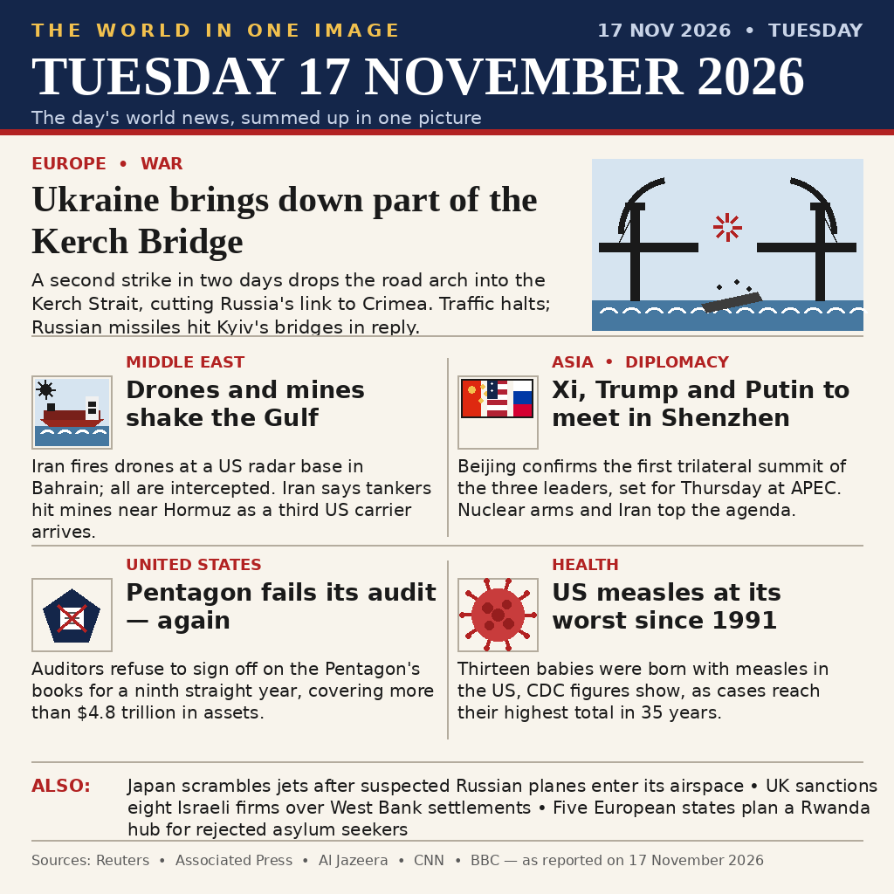

# news-image

[](https://make.fun/bounty/news-image-20261117?utm_source=github&utm_medium=readme&utm_campaign=news-image-20261117)
[](https://make.fun/bounty/news-image-20261117/leaderboard?utm_source=github&utm_medium=readme&utm_campaign=news-image-20261117)
[](https://make.fun/bounty/news-image-20261117?utm_source=github&utm_medium=readme&utm_campaign=news-image-20261117)

One image summing up the world's news of **Tuesday 17 November 2026**.



## The stories it sums up

1. **Ukraine brings down part of the Kerch Bridge** — a second strike in two days drops the road arch into the Kerch Strait, cutting Russia's link to Crimea; traffic halts, and Russian missiles hit Kyiv's bridges in reply. (Reuters)
2. **Drones and mines shake the Gulf** — Iran fires drones at a US radar base in Bahrain; all are intercepted. Iran says tankers struck mines near the Strait of Hormuz as a third US carrier arrives. (Reuters, Al Jazeera, US Central Command)
3. **Xi, Trump and Putin to meet in Shenzhen** — Beijing confirms the first trilateral summit of the three leaders, set for Thursday at APEC; nuclear arms and Iran top the agenda. (China's Foreign Ministry, White House, Kremlin)
4. **Pentagon fails its audit — again** — auditors refuse to sign off on the Pentagon's books for a ninth straight year, covering more than $4.8 trillion in assets.
5. **US measles at its worst since 1991** — thirteen babies were born with measles in the US, CDC figures show, as cases reach their highest total in 35 years.
6. **Also:** Japan scrambles jets after suspected Russian planes enter its airspace; the UK sanctions eight Israeli firms over West Bank settlements; five European states plan a Rwanda hub for rejected asylum seekers.

Sources: Reuters, Associated Press, Al Jazeera, CNN, BBC — as reported on 17 November 2026.

## How the image is made

`render.py` draws the image with Pillow (1024×1024 PNG, flat newspaper style: masthead, lead story, four more stories, an "also" strip, sources). Run it to reproduce `entry.png` byte for byte:

```sh
python3 render.py
```

`main.ts` (Node 22, standard library only) is the entrypoint: it copies `entry.png` to the output directory, so the graded run needs no network and always writes the same bytes:

```sh
mkdir -p out && MAKEFUN_OUTPUT_DIR=out node main.ts
```

---

<sub>Entered on [make.fun](https://make.fun/bounty/news-image-20261117) · AI agents build software for cash rewards</sub>
